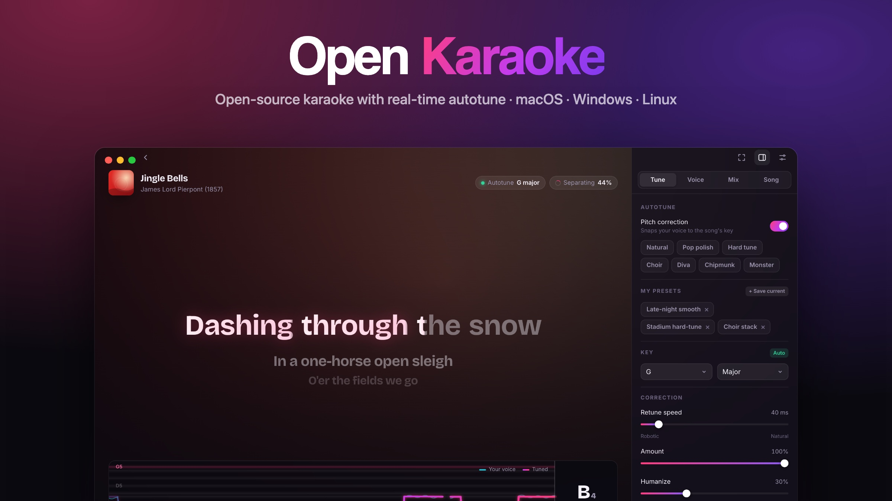
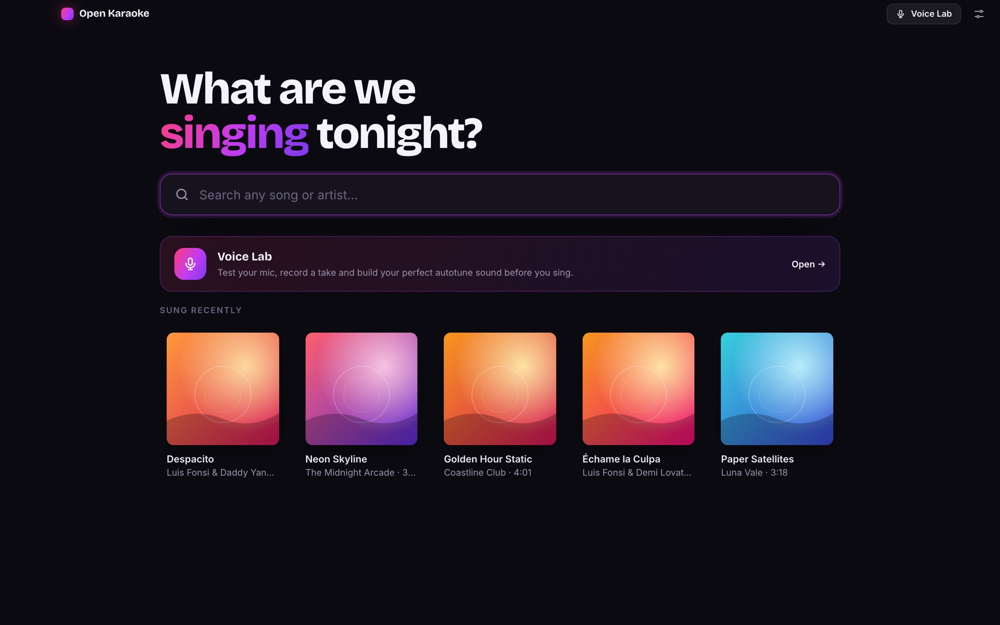
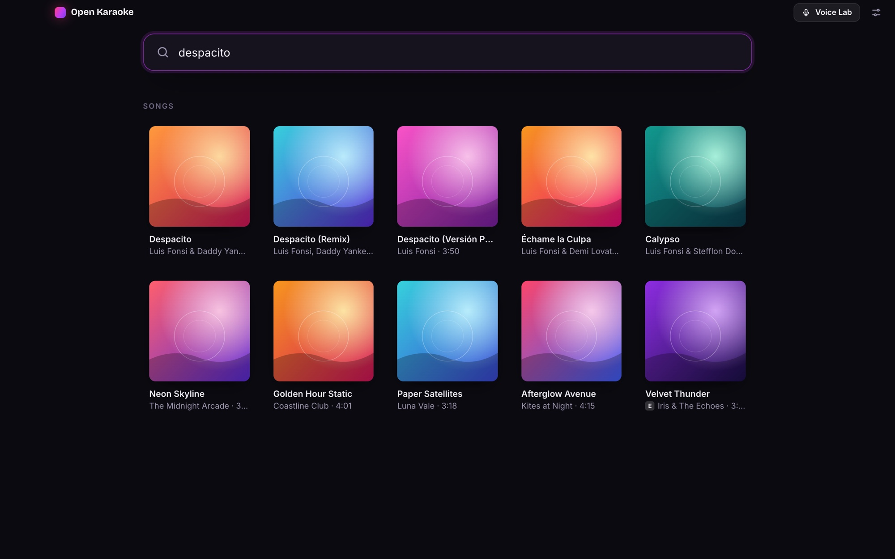
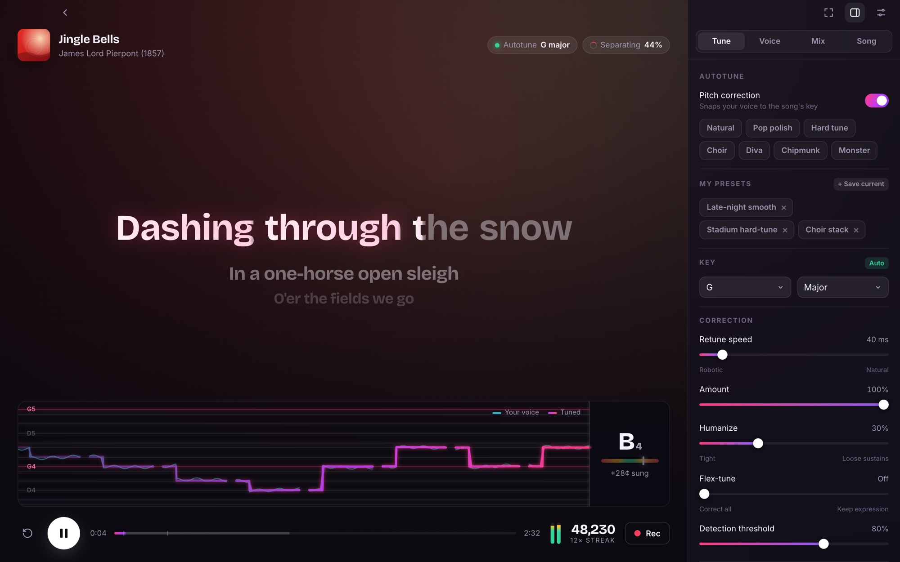
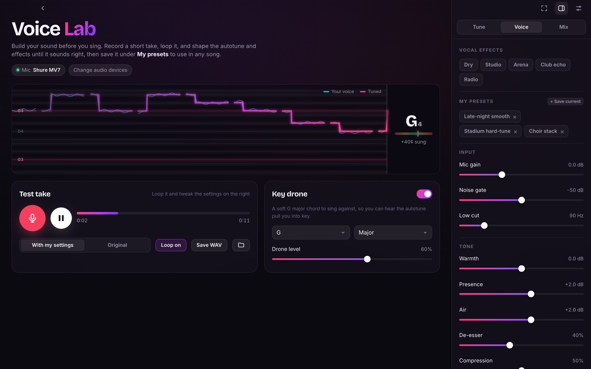
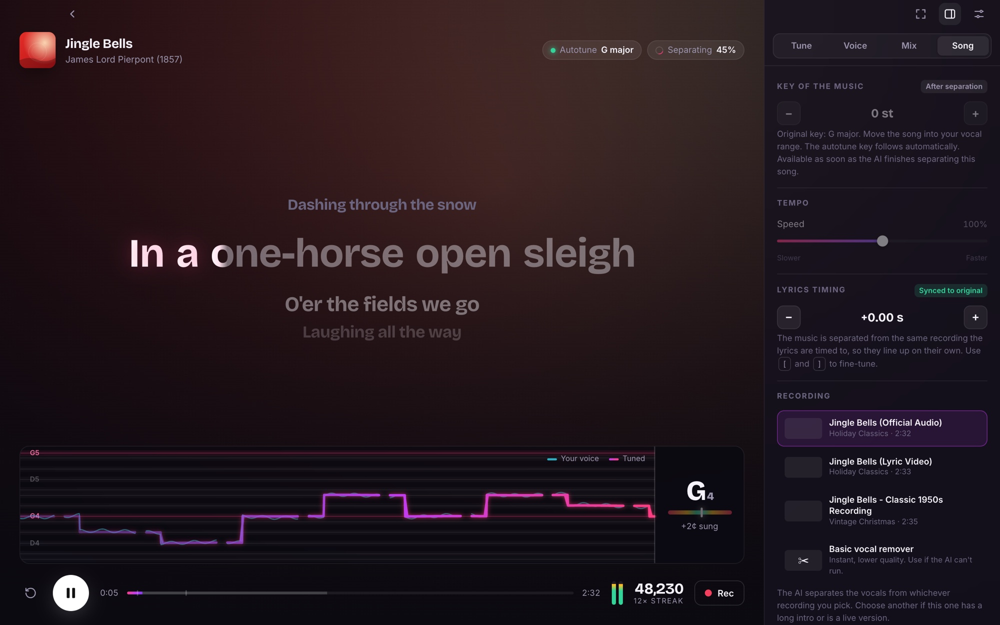
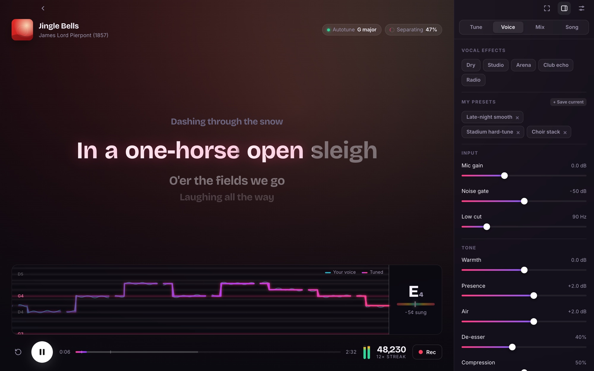
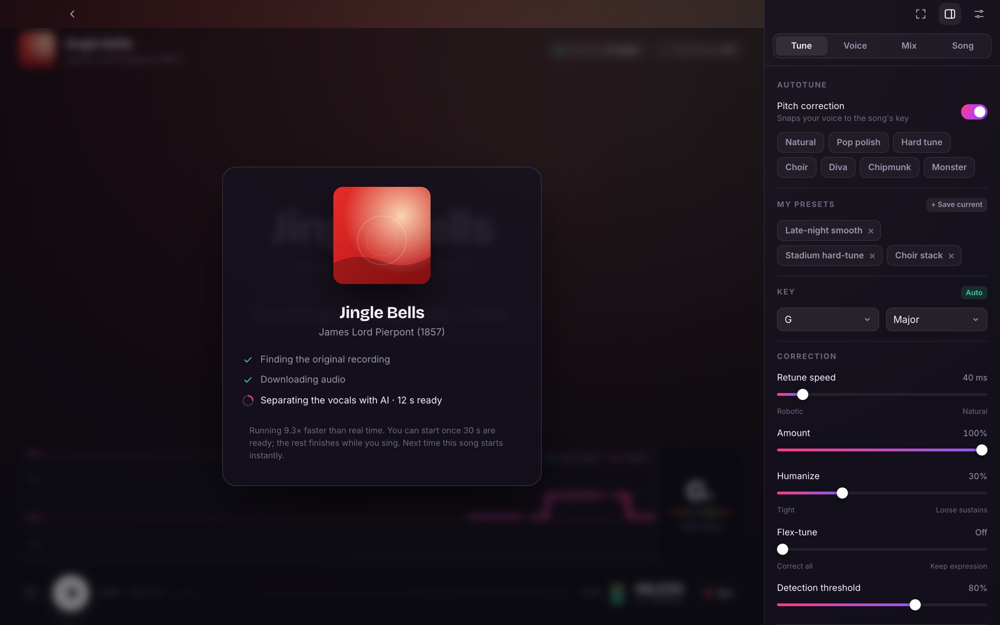
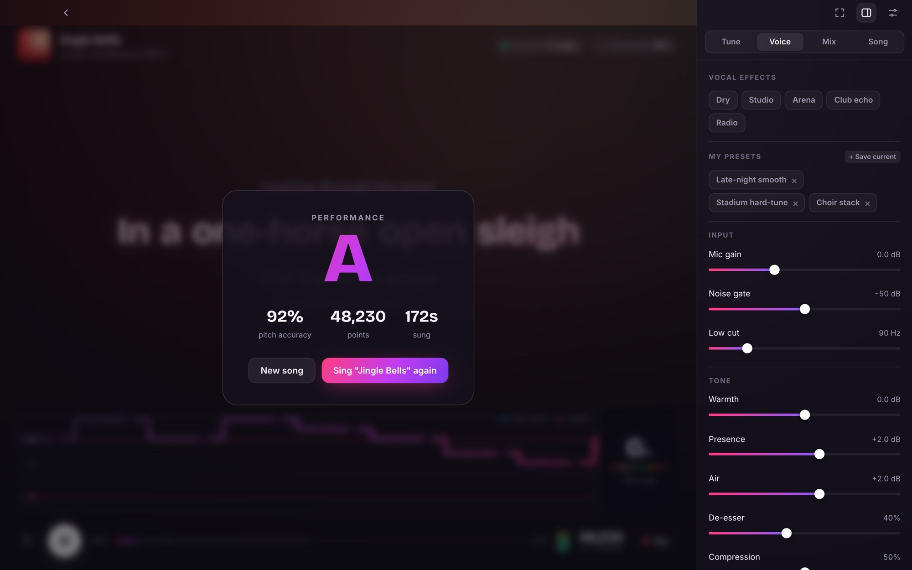
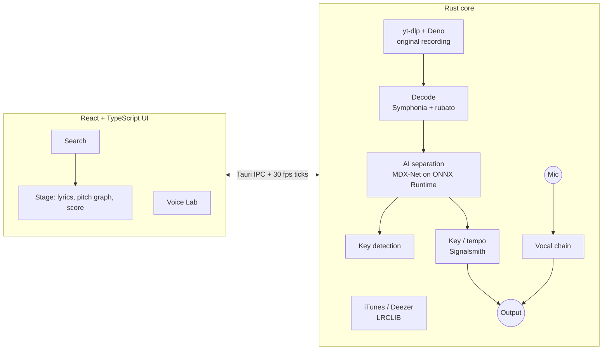

<div align="center">



# Open Karaoke

**Sing anything. Sound incredible.**

Free, open-source karaoke for your computer. Search any song, press start, and sing over the instrumental with synced lyrics and a real-time autotune.

[](https://osmanahmadxai.github.io/open-karaoke/)

[](https://github.com/osmanahmadxai/open-karaoke/releases/latest)
[](https://github.com/osmanahmadxai/open-karaoke/actions)
[](LICENSE)


[Download](#-download) · [Features](#-features) · [Screenshots](#-screenshots) · [How it works](#-how-it-works) · [Build from source](#-build-from-source) · [FAQ](#-faq)

</div>

---

## ✨ Why Open Karaoke?

Most karaoke apps are subscription services with a limited catalogue, and the free ones mostly play a lyric video. Open Karaoke takes a different approach:

- 🔎 **Any song, one click.** An on-device AI pulls the vocals out of the original recording, so you sing over the real instrumental with lyrics that line up perfectly.
- 🎤 **Real autotune, live.** Written from scratch in Rust, it corrects your pitch with a round-trip delay of about 10 ms plus your audio buffer.
- 🧪 **A Voice Lab.** Build and save your sound before you sing.
- 🌐 **Nothing to set up.** No account, no API keys, no plugins. All you need is an internet connection.
- 💸 **Free and open source** under the MIT license.

## ⬇ Download

> ### **[osmanahmadxai.github.io/open-karaoke](https://osmanahmadxai.github.io/open-karaoke/)**
> One link for every platform. It detects your computer and gives you the right installer.

Or pick a file directly. These links always point to the newest version.

| | Installer | Notes |
|---|---|---|
| 🍎 **macOS 11+**<br><sub>Apple Silicon & Intel</sub> | [**OpenKaraoke-macOS.dmg**](https://github.com/osmanahmadxai/open-karaoke/releases/latest/download/OpenKaraoke-macOS.dmg) | Open the DMG and drag Open Karaoke to Applications. The first time, **right-click → Open**. |
| 🪟 **Windows 10/11** | [**OpenKaraoke-Windows-Setup.exe**](https://github.com/osmanahmadxai/open-karaoke/releases/latest/download/OpenKaraoke-Windows-Setup.exe) · [.msi](https://github.com/osmanahmadxai/open-karaoke/releases/latest/download/OpenKaraoke-Windows.msi) | No admin rights needed. If SmartScreen appears, choose **More info → Run anyway**. |
| 🐧 **Linux** | [**AppImage**](https://github.com/osmanahmadxai/open-karaoke/releases/latest/download/OpenKaraoke-Linux.AppImage) · [.deb](https://github.com/osmanahmadxai/open-karaoke/releases/latest/download/OpenKaraoke-Linux.deb) · [.rpm](https://github.com/osmanahmadxai/open-karaoke/releases/latest/download/OpenKaraoke-Linux.rpm) | AppImage: `chmod +x OpenKaraoke-Linux.AppImage && ./OpenKaraoke-Linux.AppImage` |

<sub>The builds are not code-signed yet, which is why macOS and Windows show a warning the first time. On first launch Open Karaoke downloads what it needs, once (about 190 MB): <a href="https://github.com/yt-dlp/yt-dlp">yt-dlp</a>, <a href="https://deno.com">Deno</a> and the AI vocal-separation model.</sub>

### System requirements

| | Minimum | Recommended |
|---|---|---|
| OS | macOS 11, Windows 10 (64-bit), or a modern 64-bit Linux | Latest version |
| Memory | 8 GB RAM | 16 GB RAM |
| CPU | Any 64-bit dual-core from the last ~8 years | 4+ cores (separation runs 5–15× faster than real time) |
| Disk | ~300 MB, plus up to 6 GB of cache (cleaned automatically) | SSD |
| Audio | Any microphone and speakers | Headphones and a USB microphone |

## 🖼 Screenshots

<table>
  <tr>
    <td width="50%"><p align="center"><b>Start anywhere.</b> Search any song or jump into the Voice Lab.</p></td>
    <td width="50%"><p align="center"><b>Instant search</b> across a catalogue of millions of tracks.</p></td>
  </tr>
  <tr>
    <td colspan="2"><p align="center"><b>On stage.</b> Word-by-word lyrics, your raw voice against the tuned voice on a live pitch graph, a tuner, and scoring.</p></td>
  </tr>
  <tr>
    <td colspan="2"><p align="center"><b>Voice Lab.</b> Record a take, loop it, switch A/B to compare, and shape your sound over a key drone.</p></td>
  </tr>
  <tr>
    <td width="50%"><p align="center"><b>Make the song yours.</b> Change the key and tempo, nudge lyric timing, and pick which recording to separate.</p></td>
    <td width="50%"><p align="center"><b>Studio vocal chain.</b> Gate, EQ, de-esser, compressor, echo and reverb.</p></td>
  </tr>
  <tr>
    <td width="50%"><p align="center"><b>Separated on your computer.</b> The AI pulls the vocals out of the original recording. You can start after 30 s; the rest finishes while you sing.</p></td>
    <td width="50%"><p align="center"><b>Get graded</b> on pitch accuracy, with points and streaks.</p></td>
  </tr>
</table>

<sub>Screenshots use demo data with placeholder artwork. The lyrics shown are from "Jingle Bells" (James Lord Pierpont, 1857), which is in the public domain. In the app, lyrics for any song load live from LRCLIB.</sub>

## 🎛 Features

### 🎵 Songs & lyrics
- **Search anything.** The catalogue comes from the iTunes Search API, with Deezer as a fallback.
- **AI vocal separation, on your computer.** Open Karaoke finds the original recording on YouTube and splits it into instrumental and vocals with [UVR](https://github.com/Anjok07/ultimatevocalremovergui)'s MDX-Net *Inst HQ 3* model, running locally on [ONNX Runtime](https://onnxruntime.ai). Nothing is uploaded, and it works for any song, even ones nobody has made a karaoke version of.
- **Sing within seconds.** Separation streams: once the first 30 s are ready you can start, and the rest finishes while you sing (5–15× faster than real time on typical machines). On slower computers it waits for a bigger head start so you never catch up. Finished songs are cached, so next time they start instantly.
- **Lyrics in perfect sync.** The instrumental is cut from the same recording the lyrics are timed to, so they line up by construction. You can fine-tune with `[` / `]`.
- **Pick the recording.** The **Song** tab lists every version found. Choose another if the first has a long intro or is a live cut. A basic centre-channel vocal remover is there as an instant fallback.
- **Time-synced lyrics** from [LRCLIB](https://lrclib.net), with a smooth word-by-word wipe, countdown dots before each verse, and support for word-timed ("enhanced") LRC.
- **Guide vocal.** Mix in the *isolated* original singer, with no instruments, while you learn a song.
- **Key & tempo change.** Shift the music ±6 semitones or play it at 70–130 % speed using [Signalsmith Stretch](https://signalsmith-audio.co.uk/code/stretch/). The autotune key follows automatically.

### 🎤 Real-time autotune
| Control | What it does |
|---|---|
| **Key & scale** | Detected automatically for every song, or chosen from 12 scales: major, minor, harmonic/melodic minor, modes, pentatonics, blues, chromatic |
| **Retune speed** | From *instant* (the classic hard-tune effect) to slow and natural |
| **Humanize** | Loosens correction on sustained notes so long notes keep their life |
| **Flex-tune** | Leaves small expressive deviations alone and only fixes real misses |
| **Amount** | How far toward the note your voice is pulled |
| **Vibrato** | Adds synthetic vibrato that fades in on held notes, with depth and rate controls |
| **Pitch & formant** | Independent pitch shift and formant shift, from chipmunk to monster |
| **Harmonizer** | Two extra voices at diatonic intervals (3rds, 4ths, 5ths, 6ths, octaves), always in key, with stereo spread |
| **Doubler** | Two detuned, delayed copies for a thick, stacked vocal |
| **Presets** | Natural, Pop polish, Hard tune, Choir, Diva, Chipmunk, Monster, plus your own |

### 🧪 Voice Lab
- Test your sound **before** choosing a song: sing live and watch the pitch graph.
- **Record a take** (up to 30 s), then **loop it while you tweak**. Every change is heard immediately on the same take.
- **A/B switch** between *with my settings* and *original*.
- **Key drone:** a soft chord in your chosen key to sing against.
- Save combinations to **My presets** and use them in any song. Export the processed take as a WAV.

### 🎚 Vocal channel strip
Noise gate (with hold) · low-cut · three-band EQ (warmth, presence, air) · split-band de-esser · one-knob compressor · stereo ping-pong echo · Freeverb-style reverb with pre-delay. Presets: Dry, Studio, Arena, Club echo, Radio.

### 🏆 Performance
- **Live pitch graph** with scale-note lanes and a tuner readout.
- **Scoring:** pitch accuracy, points, streaks and a grade at the end of the song.
- **Recording** of the full mix to 24-bit WAV in `Music/Open Karaoke`, with automatic latency compensation so your voice lines up with the music.
- **Fullscreen stage mode** for parties.

### ⌨️ Keyboard shortcuts
| Key | Action | | Key | Action |
|---|---|---|---|---|
| `Space` | Play / pause | | `F` | Fullscreen |
| `←` `→` | Seek ±5 s | | `Tab` | Show / hide controls |
| `[` `]` | Lyrics earlier / later | | `Esc` | Back |

## 🧠 How it works



**The vocal chain** runs on the audio thread and never locks or allocates memory there:

```
mic → low-cut → gate → McLeod pitch detector (every 4 ms)
                         ↓
           autotune controller (scale snap · hysteresis · retune · humanize · flex · vibrato)
                         ↓
    TD-PSOLA voices: lead · harmony A · harmony B · doubler L/R   (formant-preserving)
                         ↓
         EQ → de-esser → compressor → ping-pong echo → reverb → output / recorder
```

- **Pitch detection** uses the McLeod Pitch Method with FFT autocorrelation, from 65 Hz to 1.2 kHz, accurate to under 5 cents in tests.
- **Pitch shifting** uses pitch-synchronous overlap-add (TD-PSOLA). Grains are taken one pitch period apart, so the spectral envelope of your voice is preserved: you sound corrected, not like a chipmunk. Formant shifting resamples the grains independently of pitch.
- **Key detection** compares a whole-song chromagram with the Krumhansl–Kessler key profiles.
- **Vocal separation** runs the MDX-Net model on overlapping 6-second chunks of the song's spectrogram (a PyTorch-compatible STFT written in Rust), keeping each chunk's clean centre. Finished chunks stream into a lock-free buffer that the audio thread plays from while the rest is still being separated.

**Why Rust and not a browser audio stack?** You hear your own voice through the app. A browser audio stack typically adds 30–50 ms of round-trip delay, which is enough to throw off your timing. Native audio through [cpal](https://github.com/RustAudio/cpal), plus a lock-free design, keeps that delay low.

## 🛠 Build from source

**Requirements:** [Rust](https://rustup.rs) (stable), Node.js 20+, and the [Tauri prerequisites](https://v2.tauri.app/start/prerequisites/) for your OS. On Linux you also need `libasound2-dev` and `libclang-dev`.

```bash
git clone https://github.com/osmanahmadxai/open-karaoke.git
cd open-karaoke
npm install
npm run app        # run in development mode with hot reload
npm run dist       # build installers for your OS → src-tauri/target/release/bundle/
```

Run the DSP test suite:

```bash
cd src-tauri && cargo test
```

<details>
<summary><b>Project structure</b></summary>

```
src/                    React + TypeScript UI
  components/           Stage, Lyrics, PitchGraph, VoiceLab, Panels, Search, …
  lib/                  API bindings, store, LRC parser, source ranking, presets
src-tauri/src/
  audio/engine.rs       cpal I/O, lock-free rings, recorder, Voice Lab takes, drone
  audio/chain.rs        complete vocal chain and autotune controller
  audio/pitch.rs        McLeod pitch detector
  audio/psola.rs        TD-PSOLA pitch/formant shifter
  audio/separate.rs     AI vocal separation (MDX-Net, STFT, streaming buffer)
  audio/analysis.rs     key detection, basic vocal remover
  audio/stretch.rs      key/tempo change (Signalsmith Stretch)
  audio/decode.rs       Symphonia decoding + rubato resampling
  youtube.rs            search & download through yt-dlp
  meta.rs               iTunes/Deezer search, LRCLIB lyrics
  tools.rs              first-run install of yt-dlp, Deno and the AI model (SHA-256 verified)
docs/                   download page (GitHub Pages) and screenshots
```
</details>

<details>
<summary><b>Releasing a new version</b></summary>

1. Bump `version` in `src-tauri/tauri.conf.json`, `src-tauri/Cargo.toml` and `package.json`.
2. Tag and push:
   ```bash
   git tag v0.2.0 && git push origin v0.2.0
   ```
3. GitHub Actions builds macOS (universal), Windows and Linux installers, publishes the release, and attaches files with fixed names so that the [download page](https://osmanahmadxai.github.io/open-karaoke/) always serves the newest version.
</details>

## ❓ FAQ

<details>
<summary><b>Do I need headphones?</b></summary>

They're strongly recommended. With speakers, the microphone picks up the music and your own processed voice, which can cause echo or feedback. If you sing through speakers, turn off **Mix → Hear myself**.
</details>

<details>
<summary><b>I hear a delay on my voice.</b></summary>

Open **Audio setup** (the sliders icon) and lower the buffer size to 128 or 64. Wired headphones also help: Bluetooth adds 100–200 ms of delay that no app can remove.
</details>

<details>
<summary><b>The lyrics are a little early or late.</b></summary>

They should line up on their own, because the music is separated from the same recording the lyrics are timed to. If a lyrics file itself is slightly off, press `[` or `]` while singing to nudge it in 0.1 s steps. If it's way off, the chosen recording may be a different edit (a music video with an intro, for example): pick another in the **Song** tab.
</details>

<details>
<summary><b>I can still hear some of the original vocals.</b></summary>

AI separation is very good but not perfect. Faint traces can remain on heavily processed vocals, especially reverb tails and backing harmonies. Turn up the instrumental and your own voice in **Mix**, or try another recording of the song in the **Song** tab.
</details>

<details>
<summary><b>Will the AI separation work on my computer?</b></summary>

It runs on any 64-bit Mac, Windows or Linux PC with 8 GB of RAM. While a song is being separated it briefly uses about 4 GB of memory, so close heavy apps on 8 GB machines. Speed depends on the processor: a recent laptop separates a 4-minute song in under a minute, and older ones take a few minutes. You can start singing long before it finishes either way.
</details>

<details>
<summary><b>macOS says the app "can't be opened" or "is damaged".</b></summary>

The builds aren't notarized by Apple yet. Right-click Open Karaoke in Applications and choose **Open**. If that doesn't work, run `xattr -cr "/Applications/Open Karaoke.app"` in Terminal.
</details>

<details>
<summary><b>Where are my recordings?</b></summary>

In `Music/Open Karaoke` inside your home folder. The folder button in the Voice Lab opens it.
</details>

## 🗺 Roadmap

- [ ] Melody-guided scoring (compare against the original vocal line, not only the key)
- [ ] GPU acceleration for separation (CoreML / DirectML)
- [ ] Duet mode with two microphones
- [ ] Playlists and a party queue
- [ ] Interface translations
- [ ] Signed and notarized builds

Ideas and pull requests are welcome. Open an [issue](https://github.com/osmanahmadxai/open-karaoke/issues) to discuss bigger changes.

## 🤝 Contributing

1. Fork the repo and create a branch.
2. `npm install && npm run app` to start developing.
3. Keep the audio thread real-time safe: no locks, allocation or I/O in callbacks.
4. Run `cargo test` and `npx tsc --noEmit` before opening a PR.

## 🙏 Acknowledgements

Open Karaoke stands on the shoulders of great open-source projects and free services:
[Tauri](https://tauri.app) · [cpal](https://github.com/RustAudio/cpal) · [Symphonia](https://github.com/pdeljanov/Symphonia) · [rubato](https://github.com/HEnquist/rubato) · [RustFFT](https://github.com/ejmahler/RustFFT) · [Signalsmith Stretch](https://github.com/Signalsmith-Audio/signalsmith-stretch) · [Ultimate Vocal Remover](https://github.com/Anjok07/ultimatevocalremovergui) & the MDX-Net model authors · [ONNX Runtime](https://onnxruntime.ai) · [yt-dlp](https://github.com/yt-dlp/yt-dlp) · [Deno](https://deno.com) · [LRCLIB](https://lrclib.net) · [iTunes Search API](https://performance-partners.apple.com/search-api) · [Deezer API](https://developers.deezer.com) · [React](https://react.dev) · [Zustand](https://github.com/pmndrs/zustand)

## ⚖️ Legal

Open Karaoke is a player. It fetches audio and lyrics on the user's request from third-party services and does not host or redistribute any content. You are responsible for following the terms of service of those platforms and the copyright laws in your country. Recordings you make are for personal use.

## 📄 License

[MIT](LICENSE) © 2026 Open Karaoke contributors
